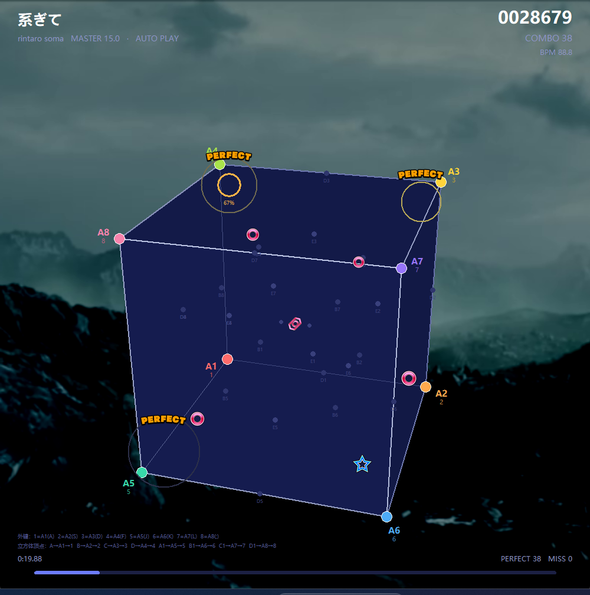

# xi_on_cube

把舞萌（maimai）谱面做成**立方体**可视化播放器：屏幕中央只有一个正方体 ABCD-A1B1C1D1，
音符从立方体中心向内部各触摸区飞出，到达即判定；滑条沿立方体的棱走真实的三维轨迹。



## 快速开始

```bat
python maimai_cube.py            :: 自动播放（默认）
python maimai_cube.py --play     :: 键盘游玩：A S D F J K L ; 或 1~8
python maimai_cube.py --stats    :: 每 5 秒打印帧耗时
python maimai_cube.py --help     :: 全部参数
```

依赖 Python 3.10+ 与 tkinter；`pillow` 可选（贴图 / 视频背景 / 曲绘），`ffmpeg` 用于播放
`pv.mp4` 背景并把 `track.mp3` 转码成可播放的 wav。

## 立方体顶点 → 触摸区 → 外键

| 顶点 | 触摸区 | 外键 | 键位 |
|---|---|---|---|
| A  | A1 | 1 | `A` / `1` |
| B  | A2 | 2 | `S` / `2` |
| C  | A3 | 3 | `D` / `3` |
| D  | A4 | 4 | `F` / `4` |
| A1 | A5 | 5 | `J` / `5` |
| B1 | A6 | 6 | `K` / `6` |
| C1 | A7 | 7 | `L` / `7` |
| D1 | A8 | 8 | `;` / `8` |

其余触摸区（B / C / D / E）按方位关系放进立方体内部，详见 [使用说明.md](使用说明.md)。

## 目录

| 路径 | 说明 |
|---|---|
| `maimai_cube.py` | 主程序（谱面解析 / 3D 渲染 / 音效 / 判定，单文件） |
| `使用说明.md` | 完整说明：运行参数、对应关系、画面、性能 |
| `11663_系ぎて/` | 示例谱面（maidata.txt）、曲绘、音频、BGA |
| `maimai音效/` | 判定音效 |
| `音符素材/` | 音符贴图 |
| `舞萌触摸区图解.xlsx` | 34 个触摸区的盘面参考图 |

## 说明

示例曲目与美术资源仅用于本地演示，版权归原作者所有。
